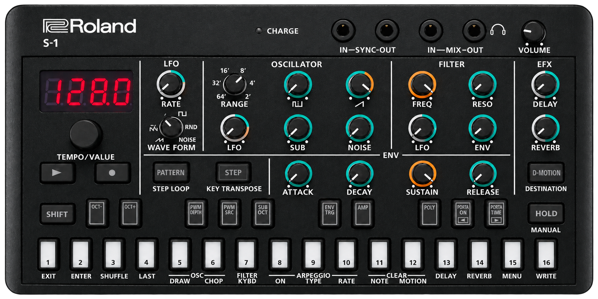
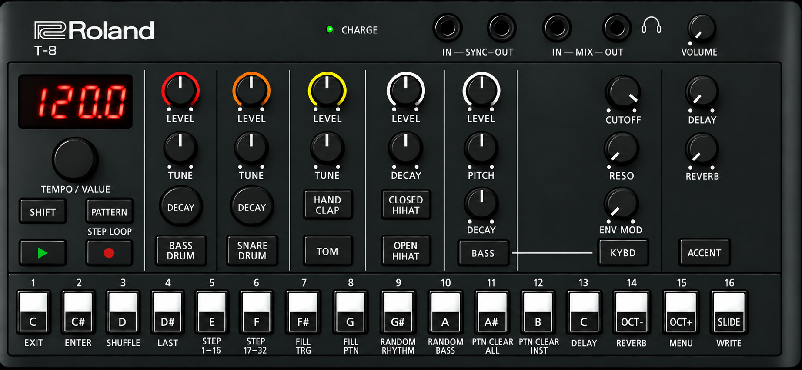
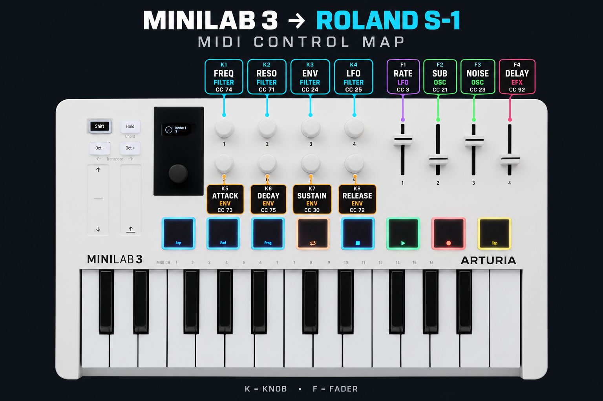

# Roland AIRA Compact S-1 synthesizer and T-8 Beat Machine: beginner courses, a pattern-file toolkit, and a MiniLab 3 controller map

A small toolkit and a set of hardware-verified findings for the `.PRM` files the
Roland S-1 writes when you run BACKUP. Firmware 1.02, tested October 2026.

Most of what is published about this format is inferred from the factory files.
Everything here was checked the other way round: send a known value into the S-1,
back it up, read what it stored.

## Rendered pages

- [S-1 Foundations](https://russellyvr.github.io/Synths/guides/s1-foundations.html), a twelve-lesson beginner course
- [T-8 Beat Foundations](https://russellyvr.github.io/Synths/guides/t8-foundations.html), with chaining to the S-1
- [S-1 Patch Inspector](https://russellyvr.github.io/Synths/guides/s1-inspector.html), open a `.PRM` backup in the browser

The two Foundations courses were written for a younger reader on purpose. The
plain wording and simplified descriptions are a deliberate choice to make the
material accessible, not a reflection of the depth of the underlying research.

## What is in the repo

| Path | What |
|---|---|
| `tools/s1_prm.py` | Parse, serialise and round-trip any `.PRM`. Byte-identical on all 64 factory files. `tools/s1_prm.py roundtrip <dir>` / `tools/s1_prm.py dump <file>` |
| `guides/s1-inspector.html` | Single-file patch inspector. Drop a `.PRM` on it, hover any knob to read the value the S-1 display shows. No build, no server |
| `docs/PRM-FORMAT.md` | The field-by-field format with each fact marked verified or inferred |
| `docs/calibration-cc.tsv` | Knob → CC → observed min/max, 32 controls, captured from the hardware over USB MIDI |
| `backups/motion-2026-10-25/` | BACKUP export where pattern 4-15 holds a known pitch-bend and CC74 sweep |
| `backups/substep-2026-10-25/` | BACKUP export where pattern 4-15 steps 1-8 hold SUBSTEP test values |
| `guides/s1-foundations.html` | Twelve-lesson beginner course for the S-1, written around the MiniLab map below |
| `guides/t8-foundations.html` | Beat-foundations course for the Roland T-8, including chaining it to the S-1 |
| `minilab3/Roland S1 v2.minilab3` | Arturia MiniLab 3 user program that puts the S-1's filter, envelope, LFO rate, sub, noise and delay on the eight knobs and four faders. Load with Arturia MIDI Control Center |

## Where this differs from S-1 Utility

[S-1 Utility](https://github.com/denzlobin/S1Utility) by denzlobin is a free desktop companion app for the S-1: a visual parameter editor over MIDI, plus a read-only Patch Inspector for browsing `.PRM` patch backups. Its author notes that parts of the app rely on heuristics, and it is built to flag uncertainty rather than guess. Testing against a real S-1 showed a few values work differently from what the app assumes:

- **Pitch bend** — the file stores a smaller range than the app expects, so a full bend plays and draws at about a quarter size.
- **Note length (LENG)** — a percentage of the step, where 100 means tie; it is not a count of timing ticks.
- **Probability (PROB)** — stored in 10 % steps, and the lowest setting is 0 %, not the manual's 1 %.
- **Substep patterns** — each of the 14 stored values maps to one pattern on the S-1 display (table below).

Byte-level details, including tempo, motion lanes, draw-wave and chop data, are in [`docs/PRM-FORMAT.md`](docs/PRM-FORMAT.md).

### SUBSTEP values

| Stored | Display | Stored | Display |
|---|---|---|---|
| 0 | `o` | 7 | `__o` |
| 1 | `oo` | 8 | `oo_` |
| 2 | `ooo` | 9 | `ooo_` (factory default) |
| 3 | `oooo` | 10 | `o_o_` |
| 4 | `oo__` | 11 | `_o_o` |
| 5 | `o_o` | 12 | `o__o` |
| 6 | `_o_` | 13 | `_oo_` |

## MiniLab 3 map for the S-1

`minilab3/Roland S1 v2.minilab3` is a MIDI Control Center program (MiniLab 3
firmware 1.2.0). Import it in MIDI Control Center and store it to one of the five
User Program slots. On the keyboard, hold **Shift** and press **Pad 3** repeatedly;
each press steps through ARTURIA, DAW and the User Programs, and the display names
the current one. Stop when it shows "Roland S1 v2". It sends on
MIDI channel 3, which is the S-1's factory channel (menu item `CH`). Every CC below
was confirmed by watching what the S-1's own knobs send over USB MIDI.

| MiniLab 3 control | CC | S-1 control | Section |
|---|---|---|---|
| Knob 1 | 74 | FREQ | FILTER |
| Knob 2 | 71 | RESO | FILTER |
| Knob 3 | 24 | ENV | FILTER |
| Knob 4 | 25 | LFO | FILTER |
| Knob 5 | 73 | ATTACK | ENV |
| Knob 6 | 75 | DECAY | ENV |
| Knob 7 | 30 | SUSTAIN | ENV |
| Knob 8 | 72 | RELEASE | ENV |
| Fader 1 | 3 | RATE | LFO |
| Fader 2 | 21 | SUB | OSC |
| Fader 3 | 23 | NOISE | OSC |
| Fader 4 | 92 | DELAY | EFX |

Keys, pitch bend and mod wheel are left at the Arturia defaults; the S-1 records
pitch bend and CC into motion lanes during real-time record, which is how the
pitch-bend finding above was produced. The full S-1 CC chart (32 controls) is in
`docs/calibration-cc.tsv`.

## File layout (short version)

689 lines, ASCII, LF, single trailing LF. 113 header lines `KEY\t= int`, then 64
`STEP_NOTE n` lines (NOTE1..LENG4, SUBSTEP, PROB), then 512 `STEP_MOTION id` lines
where `id = step*10 + tick`, tick 1-8. Key order is identical in every file.
Writers should never truncate, never rescale through CC, and preserve unknown keys.

## How the values were verified

The S-1 was clock-synced over USB MIDI, put into real-time record, and sent one
known value per 16th step. After SAVE and BACKUP the `.PRM` was diffed against the
sent values. The backup folders above are the raw evidence; re-run
`s1_prm.py dump` on them to check any claim here.

## Not included

Roland's manual text (linked by section number inside `docs/PRM-FORMAT.md` instead),
Roland's S-1 Editor, and any third-party patch packs. Only Roland's own factory
patterns and my test recordings are redistributed.

## Related

- [denzlobin/S1Utility](https://github.com/denzlobin/S1Utility) — Windows editor;
  issues [#3](https://github.com/denzlobin/S1Utility/issues/3) and
  [#4](https://github.com/denzlobin/S1Utility/issues/4) carry the pitch-bend, LENG
  and PROB corrections above.
- [Roland S-1 reference manual v1.02](https://static.roland.com/manuals/s-1_manual_v102/eng/),
  [MIDI implementation chart (section 87294690)](https://static.roland.com/manuals/s-1_manual_v102/eng/87294690.html).

MIT licence.
